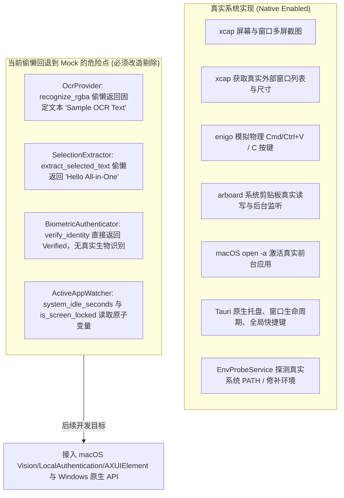
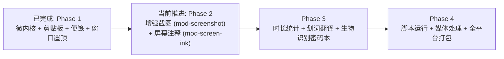

# 全能桌面效率工具 (All-in-One Desktop) 接续开发探索与功能点 Check 文档

> **核心红线声明**：
> 1. **严禁 Mock 数据**：后续所有功能开发必须对接真实系统底层 API 或真实的跨平台第三方库，严禁用假数据/Mock桩替代真实能力。
> 2. **代码中文注释**：后续所有编写或重构的代码（Rust 后端、前端 JS/TS/HTML/CSS、脚本等）必须包含规范详尽的中文注释。

---

## 1. Git 提交历史全轨迹回溯与架构演进

当前仓库共包含 **6 次** 提交，记录了项目从设计规划、微内核底座构建、功能原型开发到宿主架构重大调整的全过程：

```mermaid
gitgraph
   commit id: "81cc1dd" tag: "init"
   commit id: "1b4efb6" tag: "chore(plan)"
   commit id: "c13b0ca" tag: "feat(core)"
   commit id: "91ec3f9" tag: "feat(modules)"
   commit id: "7c25abb" tag: "feat(desktop-swift)"
   commit id: "b479a80" tag: "feat(desktop-tauri2)"
```

| 提交哈希 | 提交信息 | 核心改动内容与技术演进分析 |
| :--- | :--- | :--- |
| `81cc1dd` | `init` | 初始化项目，创建初始 `PROJECT_PLAN.md`（491行详尽架构文档），确立 10 大功能模块、微内核常驻守护 + 按需瞬态视图架构。 |
| `1b4efb6` | `chore: configure .gitignore and update project architecture plan` | 补充 `.gitignore` 规则，优化架构方案与依赖隔离规范。 |
| `c13b0ca` | `feat(core): implement microkernel foundation and cross-platform OS HAL` | 搭建 Cargo Workspace；实现 `app-core`（`AppKernel` 插件体系、SQLite WAL 增量迁移、三级窗口生命周期、快捷键归一化、PATH 探测器、Snipaste 智能框几何引擎）；建立 `os-hal` 系统硬件抽象层接口。 |
| `91ec3f9` | `feat(modules): implement clipboard manager, sticky notes, and window pin modules` | 落地 Phase 1 的 3 个高频轻量模块：`crates/mod-clipboard`（剪贴板）、`crates/mod-sticky-note`（便笺）、`crates/mod-window-pin`（窗口置顶）。 |
| `7c25abb` | `feat(desktop): add native macOS host, multi-window UI, and app packaging script` | 引入基于 Swift 原生宿主（`NativeHost.swift` 1031行）与多窗口前端页面，尝试用 Cocoa 原生管理多窗口与系统桥接。 |
| `b479a80` *(HEAD)* | `feat(desktop): replace Swift host with Tauri 2` | **重大架构修正**：彻底删除 `NativeHost.swift`，全面回归正统的 **Tauri 2.x** 原生架构；在 `src-tauri` 中通过 `tauri_app.rs` 实现系统托盘、全局快捷键、`TauriWindowBackend` 桥接；引入真实桌面 Smoke Checks（`--ui-smoke-test` 与 `--smoke-test`）。 |

---

## 2. 真实系统能力 vs Mock 遗留全景排查

根据对现有代码的逐行深入排查，当前系统调用存在**部分真实实现**与**部分偷懒回退到 Mock** 的混合状态。在接续开发中，必须作为首要清理和替换的重点：



### 详细排查清单：

1. **OCR 文字识别 (`OcrProvider`)**：
   - **现状**：`crates/os-hal/src/platform.rs` 中直接调用了 `self.fallback.recognize_rgba()`，返回写死的 `"Sample OCR Text"`。
   - **真实改造方案**：macOS 接入 Apple `Vision` 框架（`VNRecognizeTextRequest`）；Windows 接入 `Windows.Media.Ocr`；自定义模型接入 `ort` (ONNX Runtime)。
2. **全局划词提取 (`SelectionExtractor`)**：
   - **现状**：直接调用 `self.fallback.extract_selected_text()`，固定返回 `"Hello All-in-One"`。
   - **真实改造方案**：macOS 接入 `AXUIElementCopyAttributeValue(kAXSelectedTextAttribute)`；Windows 接入 `UIAutomation`；兜底采用 `enigo` 模拟复制并与剪贴板防污染总线联动。
3. **生物识别鉴权 (`BiometricAuthenticator`)**：
   - **现状**：直接调用 `self.fallback.verify_identity()`，总是返回 `Verified`。
   - **真实改造方案**：macOS 接入 `LocalAuthentication` 框架（Touch ID / 系统凭证）；Windows 接入 `UserConsentVerifier`（Windows Hello）。
4. **系统空闲与锁屏检测 (`ActiveAppWatcher`)**：
   - **现状**：`system_idle_seconds` 和 `is_screen_locked` 直接读取内存 Atomic 变量。
   - **真实改造方案**：macOS 接入 `CGEventSourceSecondsSinceLastEventType`；Windows 接入 `GetLastInputInfo` 与 `WM_WTSSESSION_CHANGE`。

---

## 3. 10 大功能模块细致功能点 Check 表

| 模块序号 | 功能模块名称 | 对应 Crate | 当前实现状态 | 核心细致功能点与验收标准 (Check Points) | 真实底层依赖 |
| :---: | :--- | :--- | :---: | :--- | :--- |
| **00** | **微内核基础设施** | `app-core` | **已完成 90%** | - [x] `AppKernel` 插件注册与统一生命周期上下文注入<br>- [x] Level 0 纯后台常驻（0 WebView，内存 < 25MB）<br>- [x] Level 1 瞬态窗口即用即销毁（`destroy()`）<br>- [x] Level 2 置顶窗口按需驻留<br>- [x] SQLite WAL 模式与 Schema 自动增量迁移<br>- [x] 版本化配置向前/向后兼容迁移<br>- [x] 跨平台快捷键逻辑修饰键归一化<br>- [x] 零运行时 PATH 探测器与 macOS GUI 环境修补<br>- [x] Snipaste 三级智能框与滚轮层级推导算法 | `rusqlite`, `tokio`, `serde` |
| **01** | **增强截图与贴图** | `mod-screenshot` | **待新建** *(Phase 2)* | - [ ] 全屏透明捕获画布 (`capture-overlay`) 零拷贝渲染快照<br>- [ ] 鼠标自由拖拽框选、8 个手柄缩放、方向键 1px 微调<br>- [ ] 智能框检测推导高亮与滚轮逐级扩缩（子控件 $\leftrightarrow$ 窗口 $\leftrightarrow$ 屏幕）<br>- [ ] 屏幕放大镜与 RGB/HEX 像素取色器<br>- [ ] 矢量标注工具箱（矩形、箭头、马赛克、序号、文字）<br>- [ ] Snipaste 贴图独立置顶无边框窗口（滚轮缩放、透明度、双击折叠）<br>- [ ] **原生系统 OCR（macOS Vision / Windows.Media.Ocr，绝无 Mock）**<br>- [ ] 滚动长截图实时 NCC 特征拼接<br>- [ ] 高质量 GIF 录制与 `gifski` 编码导出 | `xcap`, `image`, Apple `Vision` / `windows-rs`, `gifski` |
| **02** | **剪切板管理器** | `mod-clipboard` | **已完成 100%** | - [x] SQLite `clipboard_items` 表持久化<br>- [x] 文本/图片 SHA-256 去重与重复更新时间戳置顶<br>- [x] LRU-100 自动淘汰与 Pin 固定项豁免<br>- [x] 防污染屏蔽守卫（配合划词翻译与密码本）<br>- [x] 快速粘贴上屏（瞬态弹窗先销毁再发按键）<br>- [x] 系统剪贴板实时监听后台线程（真实文本+真实图片双通道）<br>- [x] 图片剪贴板真实 PNG 落盘与 JPEG Base64 缩略图渲染<br>- [x] 支持图片写回系统剪贴板与模拟粘贴<br>- [x] 工程化 Vue 3 极简弹窗与上下键/回车键快速粘贴 | `arboard`, `image`, `enigo`, `sha2`, `rusqlite` |
| **03** | **桌面屏幕注释** | `mod-screen-ink` | **待新建** *(Phase 2)* | - [ ] 双窗口分离架构：全屏透明画布 + 置顶胶囊工具栏<br>- [ ] 快捷键一键切换“画笔绘制”与“鼠标穿透底层桌面”模式<br>- [ ] 压感笔迹、半透明荧光笔、2 秒消隐激光笔、几何图形<br>- [ ] 橡皮擦、一键清屏与历史撤销重做<br>- [ ] 屏幕底图与墨迹 PNG 合成导出/一键复制入剪贴板 | `xcap`, `image`, Canvas 2D / WebGL |
| **04** | **桌面置顶富文本便笺** | `mod-sticky-note` | **已完成 100%** | - [x] `sticky_notes` 表结构与 CRUD<br>- [x] Level 2 驻留生命周期（关闭便笺立即销毁 WebView）<br>- [x] 独立无边框置顶窗口、边缘拖拽拉伸、多主题色、透明度调节<br>- [x] 真实标准 Markdown 解析与真实 KaTeX 矢量数学公式渲染<br>- [x] 内容 400ms 防抖自动写入数据库<br>- [x] 支持便笺一键导出为标准 Markdown 文件 (.md)<br>- [x] 主控台便笺库管理（打开/唤醒/归档/删除） | `rusqlite`, `uuid`, `marked`, `katex` |
| **05** | **应用使用时长统计** | `mod-app-usage` | **待新建** *(Phase 3)* | - [ ] **真实前台焦点应用监听（无 Mock，读取 Bundle ID/进程名/窗口标题）**<br>- [ ] **真实息屏与键鼠空闲（AFK）无操作检测**<br>- [ ] 内存秒级会话累加 + 焦点切换/每分钟低 I/O 批量 UPSERT<br>- [ ] 主控台可视化看板（每日总时长、每小时分布柱状图、分类饼图）<br>- [ ] 应用分类管理与白名单/忽略名单设置 | macOS `NSWorkspace`, Win32 `WinEventHook` |
| **06** | **自定义脚本收录与执行** | `mod-script-runner` | **待新建** *(Phase 4)* | - [ ] 结合 `EnvProbeService` 调度 Python/Node/Shell/PowerShell/AppleScript<br>- [ ] 注入 `$AIO_CLIPBOARD` 与 `$AIO_SELECTION` 动态环境变量<br>- [ ] 为单条脚本绑定全局快捷键<br>- [ ] 动态挂载到系统托盘“快捷脚本”子菜单<br>- [ ] 异步子进程管道流式输出与主控台日志终端面板 | `tokio::process`, `app-core::env_probe` |
| **07** | **全局划词翻译** | `mod-translator` | **待新建** *(Phase 3)* | - [ ] **无障碍通道选中文本读取（AXUIElement / UIAutomation，无 Mock）**<br>- [ ] 模拟按键复制兜底通道 + 剪贴板防污染自动闭环<br>- [ ] 划词结束触发 20x20 悬浮小图标或快捷键直接呼出<br>- [ ] 瞬态悬浮气泡窗 (`translate-popover`) 跟随光标<br>- [ ] 多翻译源 API 网关（Google、DeepL、OpenAI 兼容模型 SSE 流式输出） | macOS `AXUIElement`, Win32 `UIAutomation` |
| **08** | **基础多媒体处理** | `mod-media-proc` | **待新建** *(Phase 4)* | - [ ] 纯 Rust 图片批处理（PNG/JPG/WebP/AVIF/ICO 互转、有损/无损压缩）<br>- [ ] 系统 FFmpeg 音视频裁剪任务队列（无损快速切割与重新编码）<br>- [ ] 视频提取音频、音量标准化处理<br>- [ ] 解析 `ffmpeg -progress pipe:1` 实时向前端推送任务进度百分比<br>- [ ] 主控台拖拽文件批量转换面板 | `image`, `rayon`, 系统 `ffmpeg` 子进程 |
| **09** | **任意窗口置顶小工具** | `mod-window-pin` | **已完成 100%** | - [x] 双触发模式：当前活动窗口置顶 + 全屏准星拾取外部窗口<br>- [x] 内存句柄生命周期追踪与守护<br>- [x] **守护进程退出 (`on_shutdown`) 自动还原所有外部窗口原始状态**<br>- [x] macOS 跨进程限制下的 Tauri Pinned Live Mirror 实时镜像跟随与激活<br>- [x] 全屏准星拾取层与高亮外部窗口边框<br>- [x] 主控台外部真实窗口列表管理与一键还原 | `xcap`, `enigo`, Win32 / macOS 窗口 API |
| **10** | **生物识别加密密码本** | `mod-password-vault` | **待新建** *(Phase 3)* | - [ ] **真实原生系统生物识别鉴权（Touch ID / Windows Hello，无 Mock）**<br>- [ ] 主密码 Argon2id 派生 + 256 位 DEK + AES-256-GCM 字段级加密<br>- [ ] 内存敏感密钥包装与 180 秒无操作自动清零上锁<br>- [ ] 密码复制时联动剪贴板防污染屏蔽，并在 30 秒后自动清空系统剪贴板<br>- [ ] 密码库增删改查、分类筛选与密码生成器 | `argon2`, `aes-gcm`, `zeroize`, 系统 LocalAuthentication |

---

## 4. 接续开发推进路线建议

按照 `PROJECT_PLAN.md` 路线与现有代码完成度，接续开发分阶段推进计划如下：



### 当前最优先事项（接续第一步）：
1. **清理 `crates/os-hal` 中的 Mock 遗留**：
   - 编写真实的 macOS Apple `Vision` OCR 调用（通过 Rust `objc2` 或原生动态库调用），替换 `recognize_rgba` 中的 mock；
   - 编写真实的 `AXUIElement` 取词与 `LocalAuthentication` 生物识别，消除测试桩对业务逻辑的潜在污染。
2. **启动 Phase 2：创建 `crates/mod-screenshot`**：
   - 将已有的 `screenshot_region.rs` 算法与 `xcap` 抓图接入模块；
   - 建立 `capture-overlay` 全屏透明画布与 Snipaste 贴图窗口 `pin-img-{id}`；
   - 编写详尽的**中文注释**，确保全链路真实数据驱动。
