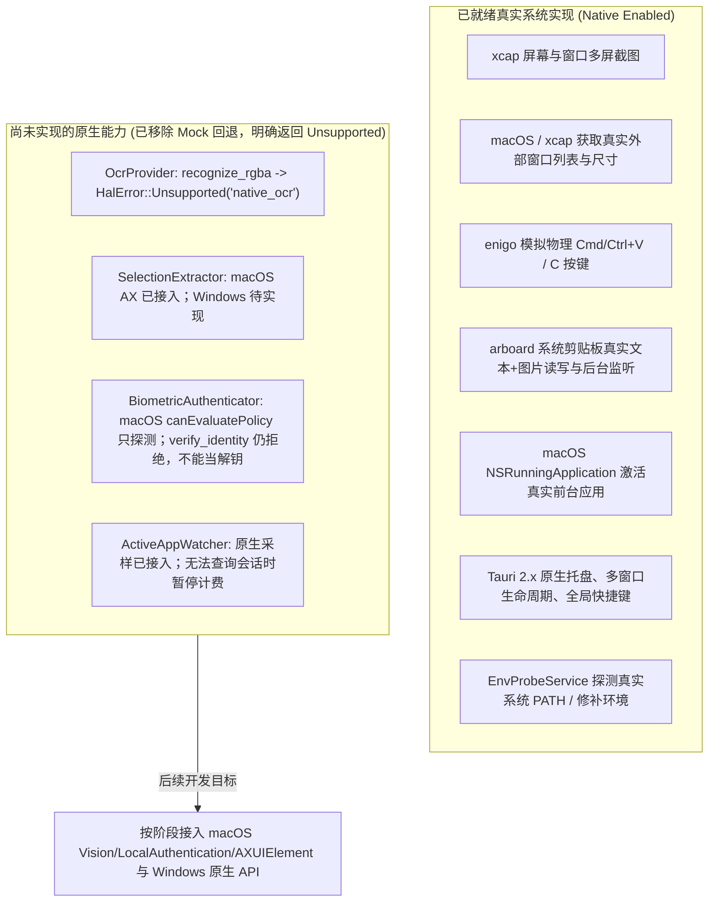
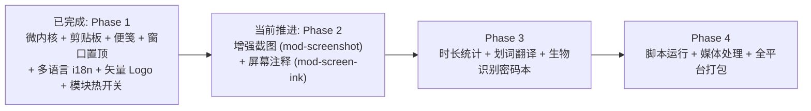

# 全能桌面效率工具 (All-in-One Desktop) 接续开发探索与功能点 Check 文档

01/05/07 本轮状态及限制见 [2026-10-25 集成报告](docs/testing/ROUND2_INTEGRATION_REPORT_2026-10-25.md)。03/06/08 三模块集成、构建和实际 GUI 执行范围见 [2026-10-24 集成报告](docs/testing/INTEGRATION_REPORT_2026-10-24.md)；待测项以该报告为准。

> **核心红线声明**：
> 1. **严禁 Mock 数据**：后续所有功能开发必须对接真实系统底层 API 或真实的跨平台第三方库，严禁用假数据/Mock桩替代真实能力。
> 2. **代码中文注释**：后续所有编写或重构的代码（Rust 后端、前端 JS/TS/HTML/CSS、脚本等）必须包含规范详尽的中文注释。
> 3. **配置、业务代码与单测严格分离**：静态配置文件/多语言字典、纯业务逻辑代码与独立单元测试必须分目录/分文件存放，严禁混写。

---

## 当前架构补充（2026-10-24）

- [x] **平台适配器拆分与生产环境零 Mock 剥离**：`NativeOsHal` 已彻底移除 `MockOsHal` 回退字段；尚未实现的原生能力明确返回 `HalError::Unsupported`，`MockOsHal` 仅用于显式的无桌面自动化测试，绝不作为生产降级。
- [x] **测试、配置与业务源码分离**：各 Crate 单元测试迁入独立 `tests/unit/` 与 `tests/`，配置结构与持久化拆分至 `config/schema.rs` 与 `config/persistence.rs`，前端多语言配置与字典拆分至 `src-ui/src/config/`、`src-ui/src/locales/` 与 `src-ui/tests/unit/`。
- [x] **十个功能槽位统一目录与运行时即时开关**：主控台总览支持即时启停已挂载积木（01–10）。密码本 M1 已挂载，使用真实主密码加密，不使用 Mock 条目。
- [x] **前端国际化多语言系统 (i18n)**：支持 `zh-CN`（简体中文）、`en-US`（English）、`ja-JP`（日本語）三语实时切换、跨 WebView 窗口秒级同步、系统托盘菜单动态本地化，并通过 `kernel_update_general_config` IPC 原子持久化至 `config.json`。
- [x] **官方高保真纯矢量 SVG 产品 Logo 与全套桌面图标**：基于「哆啦A梦四维百宝袋与竹蜻蜓旋翼道具」设计完成纯矢量 `logo.svg`、`ProductLogo.vue` 组件及 32-bit RGBA 跨平台应用/托盘图标。
- [x] **GUI 回归测试体系**：建立 [GUI 测试计划](docs/testing/GUI_TEST_PLAN.md)、测试报告与截图证据归档规范，具体接入约定以 [功能积木架构说明](docs/MODULE_ARCHITECTURE.md) 为准，新功能可从 `templates/module/` 起步。

---

## 1. Git 提交历史全轨迹回溯与架构演进

当前仓库已记录从设计规划、微内核底座构建、功能模块落地、Tauri 2.x 跨平台架构统一到模块化开关、GUI 回归与国际化 Logo 落地的完整演进轨迹：

```mermaid
gitgraph
   commit id: "81cc1dd" tag: "init"
   commit id: "1b4efb6" tag: "chore(plan)"
   commit id: "c13b0ca" tag: "feat(core)"
   commit id: "91ec3f9" tag: "feat(modules)"
   commit id: "7c25abb" tag: "feat(desktop-swift)"
   commit id: "b479a80" tag: "feat(desktop-tauri2)"
   commit id: "406377f" tag: "feat(pipeline)"
   commit id: "7c12b62" tag: "feat(vue3-hig)"
   commit id: "0971625" tag: "refactor(modular)"
   commit id: "d370a85" tag: "test(gui)"
```

| 提交哈希 | 提交信息 | 核心改动内容与技术演进分析 |
| :--- | :--- | :--- |
| `81cc1dd` | `init` | 初始化项目，创建初始 `PROJECT_PLAN.md`（491行详尽架构文档），确立 10 大功能模块、微内核常驻守护 + 按需瞬态视图架构。 |
| `1b4efb6` | `chore: configure .gitignore and update project architecture plan` | 补充 `.gitignore` 规则，优化架构方案与依赖隔离规范。 |
| `c13b0ca` | `feat(core): implement microkernel foundation and cross-platform OS HAL` | 搭建 Cargo Workspace；实现 `app-core`（`AppKernel` 插件体系、SQLite WAL 增量迁移、三级窗口生命周期、快捷键归一化、PATH 探测器、Snipaste 智能框几何引擎）；建立 `os-hal` 系统硬件抽象层接口。 |
| `91ec3f9` | `feat(modules): implement clipboard manager, sticky notes, and window pin modules` | 落地 Phase 1 的 3 个高频轻量模块：`crates/mod-clipboard`（剪贴板）、`crates/mod-sticky-note`（便笺）、`crates/mod-window-pin`（窗口置顶）。 |
| `7c25abb` | `feat(desktop): add native macOS host, multi-window UI, and app packaging script` | 早期尝试基于 Swift 原生宿主与多窗口页面管理。 |
| `b479a80` | `feat(desktop): replace Swift host with Tauri 2` | **重大架构修正**：彻底删除 `NativeHost.swift`，全面回归正统的 **Tauri 2.x** 跨平台架构；在 `src-tauri` 中通过 `tauri_app.rs` 实现系统托盘、全局快捷键、`TauriWindowBackend` 桥接。 |
| `406377f` | `feat(modules): enhance clipboard image pipeline, sticky note export, and window pin` | 完善剪贴板真实图片 PNG 落盘与缩略图管线、便笺 Markdown 导出及窗口置顶能力。 |
| `7c12b62` | `feat(ui): migrate to Vue 3 and Vite with Apple HIG styling and KaTeX rendering` | 前端全面迁移至 Vue 3 + Vite + TypeScript，落地 Apple HIG 视觉规范与 KaTeX 数学公式渲染。 |
| `dae153a` ~ `bad3cdc` | `feat/fix(winpin,theme)` | 实现 macOS 原生窗口枚举、全透明准星拾取层、Apple HIG 主题引擎及右上角轻量图钉角标生命周期管理。 |
| `0971625` | `refactor(app): modularize platform capabilities and switchable features` | 拆分 `os-hal` 平台能力文件、分离测试与业务代码、剔除生产环境 Mock 回退、落地十槽位功能积木热开关与 `config_version = 3` 迁移。 |
| `6d91a05` ~ `d370a85` | `fix(ui) & test(gui)` | 修复空剪贴板弹窗 Esc 销毁与主题跟随，完成桌面 GUI 回归测试报告与截图证据归档。 |
| *当前工作区* | `feat(ui,i18n): add multi-language i18n system and high-fidelity SVG product logo` | 完成中/英/日三语国际化配置与前后端 `config.json` 持久化联动，并将哆啦A梦百宝袋旋翼产品 Logo 转化为高保真纯矢量 SVG 与全平台图标。 |

---

## 2. 真实系统能力 vs 待实现原生能力全景排查

生产环境适配器 `NativeOsHal` 已完成与 `MockOsHal` 的彻底解耦（不再包含任何假数据回退）：



### 原生能力清理与后续接入状态：

- [x] **清理生产环境 Mock 回退（已完成）**：`crates/os-hal/src/platform/services.rs` 已彻底移除 `self.fallback` 调用，并由 `crates/os-hal/tests/capabilities.rs` 自动化测试强制守卫。
- [x] **OCR 文字识别 (`OcrProvider`) macOS 接入**：模块 01 已使用 Apple Vision。Windows `Windows.Media.Ocr` 与自定义 ONNX 仍未实现，不返回假文字。
- [ ] **全局划词提取 (`SelectionExtractor`) 原生接入**：macOS 已接入；Windows 和模拟复制待实现。原计划：接入 macOS `AXUIElementCopyAttributeValue(kAXSelectedTextAttribute)`、Windows `UIAutomation` 及 `enigo` 防污染模拟复制兜底。
- [ ] **生物识别鉴权 (`BiometricAuthenticator`) 原生接入**：macOS 已用 `LAContext.canEvaluatePolicy` 做不弹窗探测。密码本解锁不使用这个布尔值，而是读取带 `biometryCurrentSet` 的钥匙串项。Windows `UserConsentVerifier` 仍未接入。
- [ ] **系统空闲与锁屏检测 (`ActiveAppWatcher`) 原生接入**：已接入，锁屏/睡眠人工回归待执行。原计划：接入 macOS `CGEventSourceSecondsSinceLastEventType` 与 Windows `GetLastInputInfo` / `WM_WTSSESSION_CHANGE`。

---

## 3. 10 大功能模块与公共底座细致功能点 Check 表

| 模块序号 | 功能模块名称 | 对应 Crate / 目录 | 当前实现状态 | 核心细致功能点与验收标准 (Check Points) | 真实底层依赖 |
| :---: | :--- | :--- | :---: | :--- | :--- |
| **00** | **微内核与前端公共底座** | `app-core`<br>`src-tauri`<br>`src-ui` | **已完成 100%** | - [x] `AppKernel` 插件注册与统一生命周期上下文注入<br>- [x] 十槽位功能积木注册表（`MODULE_CATALOG`）与运行时动态启停开关（`set_module_enabled`）<br>- [x] Level 0 纯后台常驻（0 WebView，内存 < 25MB）<br>- [x] Level 1 瞬态窗口即用即销毁（`destroy()`）<br>- [x] Level 2 置顶窗口按需驻留<br>- [x] SQLite WAL 模式与 Schema 自动增量迁移<br>- [x] 版本化配置（`v1 -> v2 -> v3`）向前/向后兼容迁移与 schema/persistence 分离<br>- [x] 跨平台快捷键逻辑修饰键归一化與动态重绑<br>- [x] 零运行时 PATH 探测器与 macOS GUI 环境修补<br>- [x] Snipaste 三级智能框与滚轮层级推导算法<br>- [x] Apple HIG 主题引擎（浅色/深色/跟随系统 + 6 种强调色跨窗口同步）<br>- [x] **前端国际化多语言系统（`zh-CN` / `en-US` / `ja-JP` 字典分离、跨窗口同步、托盘本地化与 `config.json` 持久化）**<br>- [x] **哆啦A梦百宝袋旋翼高保真纯矢量 SVG 产品 Logo（`logo.svg`、`ProductLogo.vue` 及全套 RGBA 桌面图标）**<br>- [x] 源码、配置文件与独立单元测试（`tests/unit/`）物理分离 | `rusqlite`, `tokio`, `serde`, `tauri`, `vue` |
| **01** | **增强截图与贴图** | `mod-screenshot` | **M1–M3 已集成；录屏权限按整个 App 授予，实机截图仍待用户验收** | - [x] 冻结帧先于遮罩，帧经二进制 IPC 传输<br>- [x] 手动选区、标注、放大镜、独立贴图<br>- [x] 窗口级与控件级选区（L2 需辅助功能权限）；视觉边缘候选已接入<br>- [x] macOS Vision OCR；Windows OCR 与自定义 ONNX 未实现<br>- [x] 滚动长截图 NCC 拼接<br>- [x] GIF 录制（`gif` + `color_quant`，未使用 AGPL 的 gifski）<br>- [x] 主窗口最小化后 F1 仍能截图，不再留下 Internal kernel error；长图预览可滚动。记录见 [最小化截图修复](docs/testing/MINIMIZED_CAPTURE_FIX_2026-10-25.md)<br>- [ ] 打包 App 获得屏幕录制权限后的完整 GUI 验收 | `xcap`, `image`, Apple `Vision`, `gif`, `color_quant` |
| **02** | **剪切板管理器** | `mod-clipboard` | **已完成 100%** | - [x] SQLite `clipboard_items` 表持久化<br>- [x] 文本/图片 SHA-256 去重与重复更新时间戳置顶<br>- [x] LRU-100 自动淘汰与 Pin 固定项豁免<br>- [x] 防污染屏蔽守卫（配合划词翻译与密码本）<br>- [x] 快速粘贴上屏（瞬态弹窗先销毁再发按键）<br>- [x] 系统剪贴板实时监听后台线程（真实文本+真实图片双通道，支持模块停用休眠）<br>- [x] 图片剪贴板真实 PNG 落盘与 JPEG Base64 缩略图渲染<br>- [x] 支持图片写回系统剪贴板与模拟粘贴<br>- [x] 工程化 Vue 3 极简弹窗（含多语言、主题跟随、空列表 Esc 销毁、上下键/回车键快速粘贴） | `arboard`, `image`, `enigo`, `sha2`, `rusqlite` |
| **03** | **桌面屏幕注释** | `mod-screen-ink` | **已接入；明确不做跨屏幕注释** | - [x] 透明画布与独立工具栏、鼠标穿透<br>- [x] 画笔/荧光笔/激光笔/几何标注、撤销重做<br>- [x] 单帧底图合成、独占文件保存与复制结果反馈<br>- [x] 窗口创建失败回滚、停用销毁与事件同步<br>- [x] 跨多显示器注释：**不做**。注释保持当前单屏画布，不再排期 | `xcap`, `image`, Canvas 2D, Tauri |
| **04** | **桌面置顶富文本便笺** | `mod-sticky-note` | **已完成 100%** | - [x] `sticky_notes` 表结构与 CRUD<br>- [x] Level 2 驻留生命周期（关闭便笺立即销毁 WebView，停用模块自动收起、启用按需恢复）<br>- [x] 独立无边框置顶窗口、边缘拖拽拉伸、多主题色、透明度调节<br>- [x] 真实标准 Markdown 解析与真实 KaTeX 矢量数学公式渲染<br>- [x] 内容 400ms 防抖自动写入数据库<br>- [x] 支持便笺一键导出为标准 Markdown 文件 (.md)<br>- [x] 主控台便笺库管理（打开/唤醒/归档/删除）与全界面多语言国际化支持 | `rusqlite`, `uuid`, `marked`, `katex` |
| **05** | **应用使用时长统计** | `mod-app-usage` | **事件锁屏/睡眠与音频例外已集成，实机待验收** | - [x] 原生应用标识、单调计时、分段及批量原子落盘<br>- [x] 日报、小时分布、分类、忽略名单与当日会话列表<br>- [x] macOS 锁屏/息屏/睡眠事件与轮询合并；Windows 返回 Unsupported<br>- [x] 音频播放时的空闲例外，可关闭<br>- [ ] 实体锁屏、睡眠、音频播放的 GUI 验收 | macOS NSWorkspace / CoreAudio；Windows 未实现 |
| **06** | **自定义脚本收录与执行** | `mod-script-runner` | **已接入** | - [x] 结合 `EnvProbeService` 调度 Python/Node/Shell/PowerShell/AppleScript/Batch/VBScript<br>- [x] 显式注入真实 `$AIO_CLIPBOARD` 与 `$AIO_SELECTION`，Unsupported 不伪造<br>- [x] 为单条脚本绑定全局快捷键并接入启停生命周期<br>- [x] 动态挂载到系统托盘“快捷脚本”子菜单<br>- [x] 子进程管道流式输出、取消/超时杀进程与主控台日志面板 | `std::process`, `app-core::env_probe`, `rusqlite` |
| **07** | **全局划词翻译** | `mod-translator` | **自定义大模型已接入；鼠标划词入口待 GUI 验收** | - [x] macOS AX 与显式触发、浮窗、取消及迟到结果隔离<br>- [x] Google / DeepL / OpenAI 兼容请求与 SSE<br>- [x] 自定义提供商：模型名、HTTPS 端点、钥匙串中的 API Key。填写 `https://主机/v1` 时自动补全 `/chat/completions`<br>- [x] API Key 不写入 config.json<br>- [x] macOS 鼠标拖选入口（默认关闭、20×20 译按钮、点击后翻译、失效与停用清理），自动化测试通过<br>- [ ] 鼠标入口的真实 GUI、多应用选区验收<br>- [ ] Windows UIAutomation、模拟复制兜底（尚未实现） | macOS AXUIElement；reqwest native-tls |
| **08** | **基础多媒体处理** | `mod-media-proc` | **已接入，GUI 回归见集成报告** | - [x] PNG/JPEG/WebP/BMP/ICO 编解码、质量与缩放<br>- [x] FFmpeg 转换/裁剪/提取音频/音量调整<br>- [x] 进度、并发、取消与停用清理、历史持久化<br>- [x] FFmpeg 9.0.2 真实样本集成测试<br>- [ ] Windows 实机回归 | `image`, 本机 FFmpeg/FFprobe |
| **09** | **任意窗口置顶小工具** | `mod-window-pin` | **框架已接入；macOS 原窗口持续置顶不支持** | - [x] 双触发模式：当前活动窗口置顶 + 全屏准星拾取外部窗口<br>- [x] 内存句柄生命周期追踪与守护<br>- [x] **守护进程退出 (`on_shutdown`) 或模块停用时自动还原所有外部窗口原始状态**<br>- [x] macOS 原生高精度窗口枚举（彻底过滤 Layer 24 的 Window Server 与 Layer 20 的 Dock 等系统合成层，无 Mock）<br>- [x] 解决 macOS 无屏幕录制权限时标题丢失问题，平滑回退至 NSRunningApplication 本地化真实应用名称<br>- [x] 全屏准星拾取层彻底移除全屏暗色蒙层与模糊，采用原生 `crosshair` 十字准星与悬浮微高亮<br>- [x] 平台能力边界誠实声明（macOS `supports_external_topmost() == false` 时明确提示并禁用置顶按钮，保留窗口枚举与激活）<br>- [x] 主控台外部真实窗口列表管理、一键刷新、激活与多语言国际化支持 | `xcap`, `objc2`, `enigo`, Win32 / macOS 窗口 API |
| **10** | **加密密码本** | `mod-password-vault` | **M1 已挂载；macOS Touch ID 设备槽已接入，真机 GUI 未验收** | - [x] 主密码 Argon2id + 随机 DEK + AES-256-GCM 字段加密，虚构测试数据<br>- [x] 条目增删改查、搜索、生成器、180 秒空闲与锁屏/睡眠锁定<br>- [x] 复制密码走剪贴板租约，30 秒后仅清除仍未改动的内容<br>- [x] 不使用 Mock 密码库，不把认证布尔值当成 DEK<br>- [x] macOS：钥匙串 `biometryCurrentSet` 保存 DKEK，主密码始终可恢复；Windows Hello 未做<br>- [ ] 签名后的真机 Touch ID 成功/取消/失效尚未验收 | `argon2`, `aes-gcm`, `zeroize`, `arboard`, `security-framework` |

---

## 4. 接续开发推进路线建议

按照 `PROJECT_PLAN.md` 路线与现有代码完成度，接续开发分阶段推进计划如下：



### 当前最优先事项（接续下一步）：
1. 用打包后的 `dist/All-in-One Toolbox.app` 做截图、密码本和划词翻译的实机验收。录屏权限只授予这个 App。
2. 翻译自定义大模型由用户在界面填写模型、HTTPS 端点和钥匙串中的 Key。不把 Key 写入仓库。
3. 屏幕注释不做跨屏幕。密码本的 Windows Hello 不做。截图不做自定义 ONNX。
