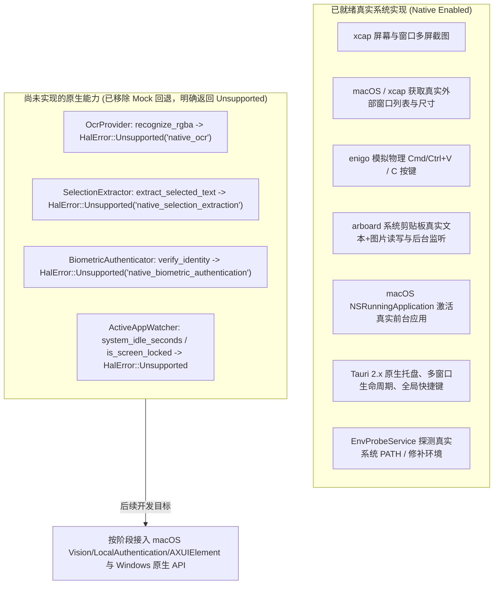
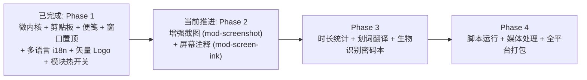

# 全能桌面效率工具 (All-in-One Desktop) 接续开发探索与功能点 Check 文档

> **核心红线声明**：
> 1. **严禁 Mock 数据**：后续所有功能开发必须对接真实系统底层 API 或真实的跨平台第三方库，严禁用假数据/Mock桩替代真实能力。
> 2. **代码中文注释**：后续所有编写或重构的代码（Rust 后端、前端 JS/TS/HTML/CSS、脚本等）必须包含规范详尽的中文注释。
> 3. **配置、业务代码与单测严格分离**：静态配置文件/多语言字典、纯业务逻辑代码与独立单元测试必须分目录/分文件存放，严禁混写。

---

## 当前架构补充（2026-10-24）

- [x] **平台适配器拆分与生产环境零 Mock 剥离**：`NativeOsHal` 已彻底移除 `MockOsHal` 回退字段；尚未实现的原生能力明确返回 `HalError::Unsupported`，`MockOsHal` 仅用于显式的无桌面自动化测试，绝不作为生产降级。
- [x] **测试、配置与业务源码分离**：各 Crate 单元测试迁入独立 `tests/unit/` 与 `tests/`，配置结构与持久化拆分至 `config/schema.rs` 与 `config/persistence.rs`，前端多语言配置与字典拆分至 `src-ui/src/config/`、`src-ui/src/locales/` 与 `src-ui/tests/unit/`。
- [x] **十个功能槽位统一目录与运行时即时开关**：主控台总览支持即时启停已挂载积木（02、04、09），其余七项明确标注「待开发」，不创建空壳模块冒充已实现能力。
- [x] **前端国际化多语言系统 (i18n)**：支持 `zh-CN`（简体中文）、`en-US`（English）、`ja-JP`（日本語）三语实时切换、跨 WebView 窗口秒级同步、系统托盘菜单动态本地化，并通过 `kernel_update_general_config` IPC 原子持久化至 `config.json`。
- [x] **官方高保真纯矢量 SVG 产品 Logo 与全套桌面图标**：基于「哆啦A梦四维百宝袋与竹蜻蜓旋翼道具」设计完成纯矢量 `logo.svg`、`ProductLogo.vue` 组件及 32-bit RGBA 跨平台应用/托盘图标。
- [x] **GUI 回归测试体系**：建立 [GUI 测试计划](docs/testing/GUI_TEST_PLAN.md)、测试报告与截图证据归档规范，具体接入约定以 [功能积木架构说明](docs/MODULE_ARCHITECTURE.md) 为准，新功能可从 `templates/module/` 起步。

---

## 1. Git 提交历史全轨迹回溯与架构演进

当前仓库已记录从设计规划、微内核底座构建、功能模块落地、Tauri 2.x 跨平台架构统一到模块化开关、GUI 回归与国际化 Logo 落地的完整演进轨迹：

```mermaid
gitgraph
   commit id: "81cc1dd" tag: "init"
   commit id: "1b4efb6" tag: "chore(plan)"
   commit id: "c13b0ca" tag: "feat(core)"
   commit id: "91ec3f9" tag: "feat(modules)"
   commit id: "7c25abb" tag: "feat(desktop-swift)"
   commit id: "b479a80" tag: "feat(desktop-tauri2)"
   commit id: "406377f" tag: "feat(pipeline)"
   commit id: "7c12b62" tag: "feat(vue3-hig)"
   commit id: "0971625" tag: "refactor(modular)"
   commit id: "d370a85" tag: "test(gui)"
```

| 提交哈希 | 提交信息 | 核心改动内容与技术演进分析 |
| :--- | :--- | :--- |
| `81cc1dd` | `init` | 初始化项目，创建初始 `PROJECT_PLAN.md`（491行详尽架构文档），确立 10 大功能模块、微内核常驻守护 + 按需瞬态视图架构。 |
| `1b4efb6` | `chore: configure .gitignore and update project architecture plan` | 补充 `.gitignore` 规则，优化架构方案与依赖隔离规范。 |
| `c13b0ca` | `feat(core): implement microkernel foundation and cross-platform OS HAL` | 搭建 Cargo Workspace；实现 `app-core`（`AppKernel` 插件体系、SQLite WAL 增量迁移、三级窗口生命周期、快捷键归一化、PATH 探测器、Snipaste 智能框几何引擎）；建立 `os-hal` 系统硬件抽象层接口。 |
| `91ec3f9` | `feat(modules): implement clipboard manager, sticky notes, and window pin modules` | 落地 Phase 1 的 3 个高频轻量模块：`crates/mod-clipboard`（剪贴板）、`crates/mod-sticky-note`（便笺）、`crates/mod-window-pin`（窗口置顶）。 |
| `7c25abb` | `feat(desktop): add native macOS host, multi-window UI, and app packaging script` | 早期尝试基于 Swift 原生宿主与多窗口页面管理。 |
| `b479a80` | `feat(desktop): replace Swift host with Tauri 2` | **重大架构修正**：彻底删除 `NativeHost.swift`，全面回归正统的 **Tauri 2.x** 跨平台架构；在 `src-tauri` 中通过 `tauri_app.rs` 实现系统托盘、全局快捷键、`TauriWindowBackend` 桥接。 |
| `406377f` | `feat(modules): enhance clipboard image pipeline, sticky note export, and window pin` | 完善剪贴板真实图片 PNG 落盘与缩略图管线、便笺 Markdown 导出及窗口置顶能力。 |
| `7c12b62` | `feat(ui): migrate to Vue 3 and Vite with Apple HIG styling and KaTeX rendering` | 前端全面迁移至 Vue 3 + Vite + TypeScript，落地 Apple HIG 视觉规范与 KaTeX 数学公式渲染。 |
| `dae153a` ~ `bad3cdc` | `feat/fix(winpin,theme)` | 实现 macOS 原生窗口枚举、全透明准星拾取层、Apple HIG 主题引擎及右上角轻量图钉角标生命周期管理。 |
| `0971625` | `refactor(app): modularize platform capabilities and switchable features` | 拆分 `os-hal` 平台能力文件、分离测试与业务代码、剔除生产环境 Mock 回退、落地十槽位功能积木热开关与 `config_version = 3` 迁移。 |
| `6d91a05` ~ `d370a85` | `fix(ui) & test(gui)` | 修复空剪贴板弹窗 Esc 销毁与主题跟随，完成桌面 GUI 回归测试报告与截图证据归档。 |
| *当前工作区* | `feat(ui,i18n): add multi-language i18n system and high-fidelity SVG product logo` | 完成中/英/日三语国际化配置与前后端 `config.json` 持久化联动，并将哆啦A梦百宝袋旋翼产品 Logo 转化为高保真纯矢量 SVG 与全平台图标。 |

---

## 2. 真实系统能力 vs 待实现原生能力全景排查

生产环境适配器 `NativeOsHal` 已完成与 `MockOsHal` 的彻底解耦（不再包含任何假数据回退）：



### 原生能力清理与后续接入状态：

- [x] **清理生产环境 Mock 回退（已完成）**：`crates/os-hal/src/platform/services.rs` 已彻底移除 `self.fallback` 调用，并由 `crates/os-hal/tests/capabilities.rs` 自动化测试强制守卫。
- [ ] **OCR 文字识别 (`OcrProvider`) 原生接入**：待在模块 01 开发时接入 macOS Apple `Vision` 框架（`VNRecognizeTextRequest`）、Windows `Windows.Media.Ocr` 及 `ort` (ONNX Runtime)。
- [ ] **全局划词提取 (`SelectionExtractor`) 原生接入**：待在模块 07 开发时接入 macOS `AXUIElementCopyAttributeValue(kAXSelectedTextAttribute)`、Windows `UIAutomation` 及 `enigo` 防污染模拟复制兜底。
- [ ] **生物识别鉴权 (`BiometricAuthenticator`) 原生接入**：待在模块 10 开发时接入 macOS `LocalAuthentication`（Touch ID / 系统凭证）与 Windows `UserConsentVerifier`（Windows Hello）。
- [ ] **系统空闲与锁屏检测 (`ActiveAppWatcher`) 原生接入**：待在模块 05 开发时接入 macOS `CGEventSourceSecondsSinceLastEventType` 与 Windows `GetLastInputInfo` / `WM_WTSSESSION_CHANGE`。

---

## 3. 10 大功能模块与公共底座细致功能点 Check 表

| 模块序号 | 功能模块名称 | 对应 Crate / 目录 | 当前实现状态 | 核心细致功能点与验收标准 (Check Points) | 真实底层依赖 |
| :---: | :--- | :--- | :---: | :--- | :--- |
| **00** | **微内核与前端公共底座** | `app-core`<br>`src-tauri`<br>`src-ui` | **已完成 100%** | - [x] `AppKernel` 插件注册与统一生命周期上下文注入<br>- [x] 十槽位功能积木注册表（`MODULE_CATALOG`）与运行时动态启停开关（`set_module_enabled`）<br>- [x] Level 0 纯后台常驻（0 WebView，内存 < 25MB）<br>- [x] Level 1 瞬态窗口即用即销毁（`destroy()`）<br>- [x] Level 2 置顶窗口按需驻留<br>- [x] SQLite WAL 模式与 Schema 自动增量迁移<br>- [x] 版本化配置（`v1 -> v2 -> v3`）向前/向后兼容迁移与 schema/persistence 分离<br>- [x] 跨平台快捷键逻辑修饰键归一化與动态重绑<br>- [x] 零运行时 PATH 探测器与 macOS GUI 环境修补<br>- [x] Snipaste 三级智能框与滚轮层级推导算法<br>- [x] Apple HIG 主题引擎（浅色/深色/跟随系统 + 6 种强调色跨窗口同步）<br>- [x] **前端国际化多语言系统（`zh-CN` / `en-US` / `ja-JP` 字典分离、跨窗口同步、托盘本地化与 `config.json` 持久化）**<br>- [x] **哆啦A梦百宝袋旋翼高保真纯矢量 SVG 产品 Logo（`logo.svg`、`ProductLogo.vue` 及全套 RGBA 桌面图标）**<br>- [x] 源码、配置文件与独立单元测试（`tests/unit/`）物理分离 | `rusqlite`, `tokio`, `serde`, `tauri`, `vue` |
| **01** | **增强截图与贴图** | `mod-screenshot` | **待新建** *(Phase 2)* | - [ ] 全屏透明捕获画布 (`capture-overlay`) 零拷贝渲染快照<br>- [ ] 鼠标自由拖拽框选、8 个手柄缩放、方向键 1px 微调<br>- [ ] 智能框检测推导高亮与滚轮逐级扩缩（子控件 $\leftrightarrow$ 窗口 $\leftrightarrow$ 屏幕）<br>- [ ] 屏幕放大镜与 RGB/HEX 像素取色器<br>- [ ] 矢量标注工具箱（矩形、箭头、马赛克、序号、文字）<br>- [ ] Snipaste 贴图独立置顶无边框窗口（滚轮缩放、透明度、双击折叠）<br>- [ ] **原生系统 OCR（macOS Vision / Windows.Media.Ocr，绝无 Mock）**<br>- [ ] 滚动长截图实时 NCC 特征拼接<br>- [ ] 高质量 GIF 录制与 `gifski` 编码导出 | `xcap`, `image`, Apple `Vision` / `windows-rs`, `gifski` |
| **02** | **剪切板管理器** | `mod-clipboard` | **已完成 100%** | - [x] SQLite `clipboard_items` 表持久化<br>- [x] 文本/图片 SHA-256 去重与重复更新时间戳置顶<br>- [x] LRU-100 自动淘汰与 Pin 固定项豁免<br>- [x] 防污染屏蔽守卫（配合划词翻译与密码本）<br>- [x] 快速粘贴上屏（瞬态弹窗先销毁再发按键）<br>- [x] 系统剪贴板实时监听后台线程（真实文本+真实图片双通道，支持模块停用休眠）<br>- [x] 图片剪贴板真实 PNG 落盘与 JPEG Base64 缩略图渲染<br>- [x] 支持图片写回系统剪贴板与模拟粘贴<br>- [x] 工程化 Vue 3 极简弹窗（含多语言、主题跟随、空列表 Esc 销毁、上下键/回车键快速粘贴） | `arboard`, `image`, `enigo`, `sha2`, `rusqlite` |
| **03** | **桌面屏幕注释** | `mod-screen-ink` | **待新建** *(Phase 2)* | - [ ] 双窗口分离架构：全屏透明画布 + 置顶胶囊工具栏<br>- [ ] 快捷键一键切换“画笔绘制”与“鼠标穿透底层桌面”模式<br>- [ ] 压感笔迹、半透明荧光笔、2 秒消隐激光笔、几何图形<br>- [ ] 橡皮擦、一键清屏与历史撤销重做<br>- [ ] 屏幕底图与墨迹 PNG 合成导出/一键复制入剪贴板 | `xcap`, `image`, Canvas 2D / WebGL |
| **04** | **桌面置顶富文本便笺** | `mod-sticky-note` | **已完成 100%** | - [x] `sticky_notes` 表结构与 CRUD<br>- [x] Level 2 驻留生命周期（关闭便笺立即销毁 WebView，停用模块自动收起、启用按需恢复）<br>- [x] 独立无边框置顶窗口、边缘拖拽拉伸、多主题色、透明度调节<br>- [x] 真实标准 Markdown 解析与真实 KaTeX 矢量数学公式渲染<br>- [x] 内容 400ms 防抖自动写入数据库<br>- [x] 支持便笺一键导出为标准 Markdown 文件 (.md)<br>- [x] 主控台便笺库管理（打开/唤醒/归档/删除）与全界面多语言国际化支持 | `rusqlite`, `uuid`, `marked`, `katex` |
| **05** | **应用使用时长统计** | `mod-app-usage` | **待新建** *(Phase 3)* | - [ ] **真实前台焦点应用监听（无 Mock，读取 Bundle ID/进程名/窗口标题）**<br>- [ ] **真实息屏与键鼠空闲（AFK）无操作检测**<br>- [ ] 内存秒级会话累加 + 焦点切换/每分钟低 I/O 批量 UPSERT<br>- [ ] 主控台可视化看板（每日总时长、每小时分布柱状图、分类饼图）<br>- [ ] 应用分类管理与白名单/忽略名单设置 | macOS `NSWorkspace`, Win32 `WinEventHook` |
| **06** | **自定义脚本收录与执行** | `mod-script-runner` | **待新建** *(Phase 4)* | - [ ] 结合 `EnvProbeService` 调度 Python/Node/Shell/PowerShell/AppleScript<br>- [ ] 注入 `$AIO_CLIPBOARD` 与 `$AIO_SELECTION` 动态环境变量<br>- [ ] 为单条脚本绑定全局快捷键<br>- [ ] 动态挂载到系统托盘“快捷脚本”子菜单<br>- [ ] 异步子进程管道流式输出与主控台日志终端面板 | `tokio::process`, `app-core::env_probe` |
| **07** | **全局划词翻译** | `mod-translator` | **待新建** *(Phase 3)* | - [ ] **无障碍通道选中文本读取（AXUIElement / UIAutomation，无 Mock）**<br>- [ ] 模拟按键复制兜底通道 + 剪贴板防污染自动闭环<br>- [ ] 划词结束触发 20x20 悬浮小图标或快捷键直接呼出<br>- [ ] 瞬态悬浮气泡窗 (`translate-popover`) 跟随光标<br>- [ ] 多翻译源 API 网关（Google、DeepL、OpenAI 兼容模型 SSE 流式输出） | macOS `AXUIElement`, Win32 `UIAutomation` |
| **08** | **基础多媒体处理** | `mod-media-proc` | **待新建** *(Phase 4)* | - [ ] 纯 Rust 图片批处理（PNG/JPG/WebP/AVIF/ICO 互转、有损/无损压缩）<br>- [ ] 系统 FFmpeg 音视频裁剪任务队列（无损快速切割与重新编码）<br>- [ ] 视频提取音频、音量标准化处理<br>- [ ] 解析 `ffmpeg -progress pipe:1` 实时向前端推送任务进度百分比<br>- [ ] 主控台拖拽文件批量转换面板 | `image`, `rayon`, 系统 `ffmpeg` 子进程 |
| **09** | **任意窗口置顶小工具** | `mod-window-pin` | **框架已接入；macOS 原窗口持续置顶不支持** | - [x] 双触发模式：当前活动窗口置顶 + 全屏准星拾取外部窗口<br>- [x] 内存句柄生命周期追踪与守护<br>- [x] **守护进程退出 (`on_shutdown`) 或模块停用时自动还原所有外部窗口原始状态**<br>- [x] macOS 原生高精度窗口枚举（彻底过滤 Layer 24 的 Window Server 与 Layer 20 的 Dock 等系统合成层，无 Mock）<br>- [x] 解决 macOS 无屏幕录制权限时标题丢失问题，平滑回退至 NSRunningApplication 本地化真实应用名称<br>- [x] 全屏准星拾取层彻底移除全屏暗色蒙层与模糊，采用原生 `crosshair` 十字准星与悬浮微高亮<br>- [x] 平台能力边界誠实声明（macOS `supports_external_topmost() == false` 时明确提示并禁用置顶按钮，保留窗口枚举与激活）<br>- [x] 主控台外部真实窗口列表管理、一键刷新、激活与多语言国际化支持 | `xcap`, `objc2`, `enigo`, Win32 / macOS 窗口 API |
| **10** | **生物识别加密密码本** | `mod-password-vault` | **待新建** *(Phase 3)* | - [ ] **真实原生系统生物识别鉴权（Touch ID / Windows Hello，无 Mock）**<br>- [ ] 主密码 Argon2id 派生 + 256 位 DEK + AES-256-GCM 字段级加密<br>- [ ] 内存敏感密钥包装与 180 秒无操作自动清零上锁<br>- [ ] 密码复制时联动剪贴板防污染屏蔽，并在 30 秒后自动清空系统剪贴板<br>- [ ] 密码库增删改查、分类筛选与密码生成器 | `argon2`, `aes-gcm`, `zeroize`, 系统 LocalAuthentication |

---

## 4. 接续开发推进路线建议

按照 `PROJECT_PLAN.md` 路线与现有代码完成度，接续开发分阶段推进计划如下：



### 当前最优先事项（接续下一步）：
1. **启动 Phase 2：基于 `templates/module/` 创建 `crates/mod-screenshot`（01 增强截图与贴图）**：
   - 将已有的 `screenshot_region.rs` 算法与 `xcap` 抓图接入模块；
   - 建立 `capture-overlay` 全屏透明画布与 Snipaste 贴图窗口 `pin-img-{id}`；
   - 接入真实 macOS Apple `Vision` OCR / Windows `Windows.Media.Ocr`；
   - 严格保持「配置、业务代码、单测分离」与详尽**中文注释**。
2. **创建 `crates/mod-screen-ink`（03 桌面屏幕注释）**：
   - 落地 `screen-ink-canvas` 全屏透明画布与 `screen-ink-toolbar` 胶囊工具栏双窗口联动及鼠标穿透控制。
