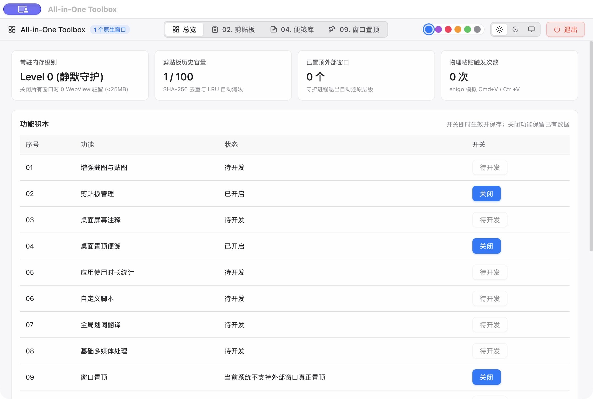

# macOS GUI 回归执行报告 — 2026-10-24

## 结论

已实际执行 [测试计划](GUI_TEST_PLAN.md) 中的 20 条用例：**19 条通过，1 条全局快捷键待实体键盘复核**。发现并修复 4 处界面缺陷，修复后重新打包并进行针对性复测。不能将本轮结果标为“GUI 全绿”：GUI-06 的系统级热键触发仍需人工确认。

本轮通过 Computer Use 对真实 App 执行点击、输入、复制、主题切换、原生菜单窗口切换和退出/重启；未用 IPC 或数据库查询替代 GUI 断言。保存 26 张原始界面截图及 [截图校验清单](evidence/2026-10-24/index.json)，并提供 [机器可读结果](gui-results-2026-10-24.json)。

## 构建与环境

| 项目 | 记录 |
| --- | --- |
| 执行时间 | 2026-10-24 16:45—17:06，Asia/Shanghai |
| 系统 | macOS 27.0，构建 26A428，arm64 |
| App 版本 | 0.1.0，release，本地未签名构建 |
| 最新交付包 | `dist/All-in-One Toolbox.app` |
| QA 副本 | `.runtime_data/gui-qa/All-in-One Toolbox QA.app` |
| 数据隔离 | `.runtime_data/gui-qa-20261024/`，真实 OS HAL，无 Mock |
| 最终可执行文件 SHA-256 | `200870cb021000824c861072e4990de6960698d4a0376135736edce8e159c121` |
| 源码基点 | `bad3cdc675a25993371fd92f99f7b2329dc91b2a`，含当前未提交的重构及 GUI 修复 |
| 构建清单 | [JSON](build-manifest-2026-10-24.json) |

QA 副本通过 Info.plist 的 `LSEnvironment` 指定测试数据目录，并使用独立 bundle 身份；可执行文件与交付包字节一致。标准 App 不携带 QA 数据目录设置。可通过 `scripts/prepare_gui_test_app.py` 重建该测试副本。测试期间多次退出、重启均复用同一隔离目录。

本轮构建顺序：首次完整检查发现缺陷 → 修复提示/空列表 Escape/浅色对比并重包 → 完成功能、采集隔离和重启测试 → 修复子组件标题排版并重包 → 复测最终排版、深浅主题、新弹窗继承和退出。最后一次只修改模块标题 CSS，不改变此前已验证的业务行为。

## 用例结果

| ID | 结果 | 实际观察 | 截图 |
| --- | --- | --- | --- |
| GUI-01 | 通过 | 最新 release App 正常启动，主控台无白屏；最终仅一个主控台窗口。 | [22](evidence/2026-10-24/22-final-module-layout.png) |
| GUI-02 | 通过 | 已查看十个槽位并滚动至第十项；02/04/09 可开关，其余七项为待开发且禁用。 | [21](evidence/2026-10-24/21-catalog-and-shortcuts.png)、[22](evidence/2026-10-24/22-final-module-layout.png) |
| GUI-03 | 通过 | 实际切换三个功能页与总览；空列表、归档列表正常。剪贴板串页提示修复后复测通过。 | [12](evidence/2026-10-24/12-clipboard-notice-fixed.png)、[25](evidence/2026-10-24/25-final-archived-note.png)、[19](evidence/2026-10-24/19-final-window-pin-limit.png) |
| GUI-04 | 通过 | 实际切换深色、浅色、跟随系统及紫色强调色，观察新弹窗同步主题；最终恢复浅色/经典蓝。 | [23](evidence/2026-10-24/23-final-dark-theme.png)、[24](evidence/2026-10-24/24-final-dark-popup.png)、[26](evidence/2026-10-24/26-final-restored-switches.png) |
| GUI-05 | 通过 | 关闭剪贴板后标签和快捷键行移除；便笺仍可使用。 | [07](evidence/2026-10-24/07-clipboard-disabled.png)、[16](evidence/2026-10-24/16-after-restart-disabled-state.png) |
| GUI-06 | 待复核 | 已执行关闭/开启和 ⇧⌘V 按键注入；关闭时不弹出，开启后标签/快捷键恢复，但注入按键没有打开弹窗。按钮入口正常。实体键盘行为尚未验证，不能标为通过。 | [07](evidence/2026-10-24/07-clipboard-disabled.png)、[21](evidence/2026-10-24/21-catalog-and-shortcuts.png) |
| GUI-07 | 通过 | 修复后无搜索结果时 Escape 关闭弹窗；另通过原生 Window 菜单将主控台设为键盘窗口，弹窗销毁，之后可重新创建。 | [13](evidence/2026-10-24/13-popup-light-empty-fixed.png) |
| GUI-08 | 通过 | 新建 GUI-QA-20261024 便笺，输入中英文 Markdown/LaTeX；界面显示已保存。 | [10](evidence/2026-10-24/10-sticky-markdown-preview.png)、[11](evidence/2026-10-24/11-sticky-theme-opacity.png) |
| GUI-09 | 通过 | 编辑/预览往返后标题、粗体、列表及 E=mc² 渲染正常，源码未丢失。 | [10](evidence/2026-10-24/10-sticky-markdown-preview.png)、[20](evidence/2026-10-24/20-sticky-restored-after-restart.png) |
| GUI-10 | 通过 | 便笺由 neutral/95% 调整为 sky/68%，窗口颜色和透明度实际变化；关闭、重开、重启后保留。 | [11](evidence/2026-10-24/11-sticky-theme-opacity.png)、[20](evidence/2026-10-24/20-sticky-restored-after-restart.png)、[25](evidence/2026-10-24/25-final-archived-note.png) |
| GUI-11 | 通过 | 便笺关闭后库中显示已归档关闭；点击唤醒窗口后原内容、标题、sky/68% 恢复。 | [25](evidence/2026-10-24/25-final-archived-note.png)、[20](evidence/2026-10-24/20-sticky-restored-after-restart.png) |
| GUI-12 | 通过 | 便笺打开时关闭模块：标签/快捷键移除，原生窗口数从 2 降为 1；重新启用自动恢复原便笺。 | [14](evidence/2026-10-24/14-sticky-disabled.png)、[20](evidence/2026-10-24/20-sticky-restored-after-restart.png) |
| GUI-13 | 通过 | 从便笺实际选中文本并 ⌘C，出现一条含 ALPHA 标记的历史；重复复制相同源码后仍为一条。 | [12](evidence/2026-10-24/12-clipboard-notice-fixed.png)、[21](evidence/2026-10-24/21-catalog-and-shortcuts.png) |
| GUI-14 | 通过 | ALPHA 搜索匹配，NO-MATCH 搜索为空；在弹窗点击固定后变为已固定/取消固定，重开及重启后仍保留。 | [13](evidence/2026-10-24/13-popup-light-empty-fixed.png)、[24](evidence/2026-10-24/24-final-dark-popup.png) |
| GUI-15 | 通过 | 关闭模块后复制 GUI-QA-DISABLED-BETA-20261024，恢复模块后仅有原 ALPHA 记录，搜索 BETA 无结果。 | [17](evidence/2026-10-24/17-disabled-copy-not-captured.png) |
| GUI-16 | 通过 | 窗口枚举/刷新可用，筛选不存在文本显示空结果；macOS 限制提示明确，置顶当前窗口和准星按钮禁用。 | [19](evidence/2026-10-24/19-final-window-pin-limit.png) |
| GUI-17 | 通过 | 窗口置顶模块关闭时标签消失，开启后恢复；未产生置顶目标或残留角标。 | [18](evidence/2026-10-24/18-window-pin-disabled.png)、[19](evidence/2026-10-24/19-final-window-pin-limit.png) |
| GUI-18 | 通过 | 保持剪贴板关闭后从界面退出并重启同一 QA App；关闭状态、缺失入口和缺失快捷键均保留。 | [15](evidence/2026-10-24/15-before-restart.png)、[16](evidence/2026-10-24/16-after-restart-disabled-state.png) |
| GUI-19 | 通过 | 退出前保持便笺打开；重启后窗口数为 2，原便笺实际恢复，内容/公式/标题/68% 正确。 | [15](evidence/2026-10-24/15-before-restart.png)、[16](evidence/2026-10-24/16-after-restart-disabled-state.png)、[20](evidence/2026-10-24/20-sticky-restored-after-restart.png) |
| GUI-20 | 通过 | 三模块恢复开启，主题恢复浅色/蓝色，测试便笺归档；通过界面退出，Computer Use 返回 App quit。记录保留在隔离目录用于复核。 | [25](evidence/2026-10-24/25-final-archived-note.png)、[26](evidence/2026-10-24/26-final-restored-switches.png) |

## 缺陷与修复

| 编号 | 严重性 | 复现与原因 | 修复及复测 |
| --- | --- | --- | --- |
| GUI-D01 | P2 | macOS 打开剪贴板页，错误出现外部窗口置顶的系统限制提示；同一提示被重复插入两个页面。 | 从剪贴板分支移除提示，仅窗口置顶页保留。对比 [修复前](evidence/2026-10-24/05-defect-clipboard-notice.png) / [修复后](evidence/2026-10-24/12-clipboard-notice-fixed.png)。 |
| GUI-D02 | P2 | 剪贴板为空或搜索无结果时 Escape 不关闭弹窗；处理函数先按列表长度提前返回，未处理 Escape。 | 把 Escape 生命周期操作移到空列表检查之前。实际在无结果状态按 Escape，返回主控台；[无结果证据](evidence/2026-10-24/13-popup-light-empty-fixed.png)。 |
| GUI-D03 | P2 | 浅色模式下剪贴板弹窗强制深色背景，但文字仍为浅色主题的深色文字，标题/提示对比不足。 | 背景改为全局主题变量。对比 [修复前](evidence/2026-10-24/08-clipboard-popup.png) / [浅色修复后](evidence/2026-10-24/13-popup-light-empty-fixed.png) / [深色复测](evidence/2026-10-24/24-final-dark-popup.png)。 |
| GUI-D04 | P3 | 功能积木卡片的标题与描述直接相连；拆出 Vue 子组件后未继承父组件 scoped 标题样式。 | 子组件自行维护标题、描述、间距与换行布局；[最终浅色](evidence/2026-10-24/22-final-module-layout.png) / [最终深色](evidence/2026-10-24/23-final-dark-theme.png)。 |

改动位置：`src-ui/src/components/Dashboard.vue`、`ClipboardPopup.vue`、`ModuleManager.vue`。另增加 `src-tauri/tests/support/gui_test.rs` 和启动时的测试目录读取，用于数据隔离；不注入模拟系统能力。

## 尚未确认的全局快捷键

GUI-06 的操作已经执行：关闭模块时注入 ⇧⌘V 不弹出，开启后快捷键行恢复；但开启时注入 ⇧⌘V 仍未触发弹窗。按钮入口、窗口创建、系统快捷键同步注册均能执行。应用内的 ⌘A/⌘C、Escape 可由自动化正常触发。

**原因未确认**。定向按键注入与 macOS 全局热键处理机制的差异是一种可能，不能据此认定产品实体键盘快捷键正常，也不能直接归因于 macOS 不支持。保留为待复核项，不计入通过。

实体键盘复核步骤：

1. 启动 QA App，开启剪贴板模块，确保弹窗已关闭。
2. 实体键盘按 ⇧⌘V，验证弹窗出现；再按 Escape 关闭。
3. 将其他应用设为前台，再按 ⇧⌘V，验证全局触发。
4. 关闭剪贴板模块，重复按键应不触发；重新开启后应恢复。
5. 若仍不触发，记录键盘布局、其他热键冲突及具体前台应用，作为 GUI-D05 正式缺陷继续排查。

## 配套验证与收尾

- 前端 `vue-tsc --noEmit && vite build`：通过。
- `.app` release 编译及复制至 `dist/`：通过；最终文件 hash 与清单一致。
- `cargo test --workspace --offline --all-targets`：22 项通过、0 失败，1 项需要桌面会话的窗口枚举测试显式忽略。
- 测试结束时三模块均开启、浅色/经典蓝；便笺处于归档状态，只保留主控台后通过界面退出。
- 保留一份测试便笺和一条已固定的测试剪贴板历史，均在隔离目录，便于后续复现；未清空或删除日常用户数据。
- 为验证真实捕获执行过 ⌘C，系统剪贴板最后复制的是专用 BETA 测试文本；未读取或备份测试前的剪贴板内容。
- 未覆盖：Windows 实机、图片剪贴板、LRU 极限容量、多显示器、导出文件下载、外部应用自动粘贴，以及截图/翻译等七个尚未实现功能。这些不计入本轮 20 条回归的通过数。

